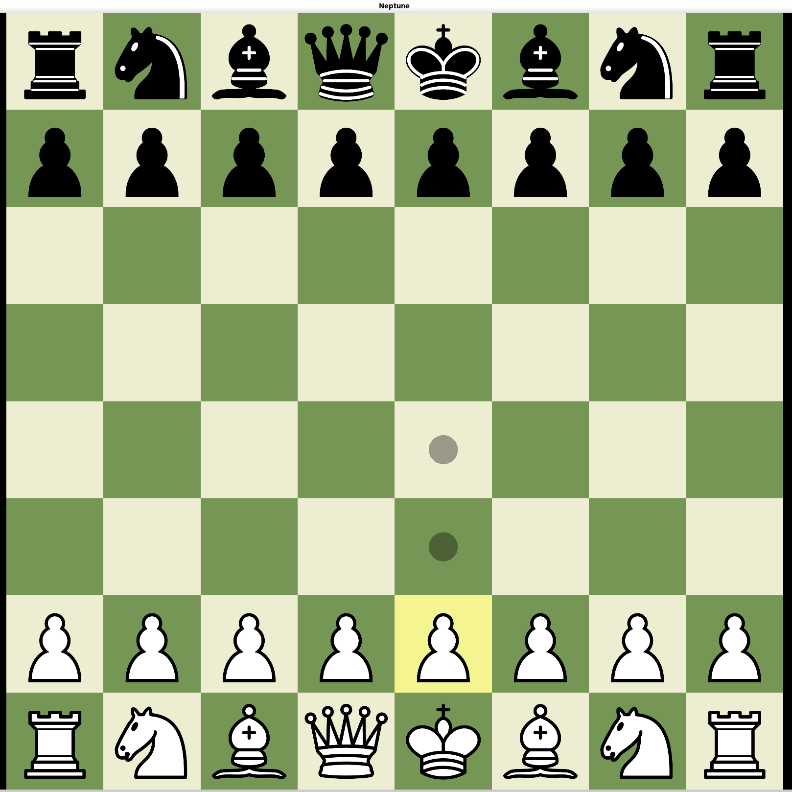

# ♆ Neptune

*Chess game written in C++23.*

Neptune is a simple chess game with nice UI.

---

## Features

### Current

- ♟️ Playable chess game with most of the chess rules (missing 50-move rule and insufficient material draw)
- ✅ Legal move generation
- ♖  Castling
- 🔄 Pawn promotion
- 📖 FEN import
- 🎨 Graphical interface built with SFML and Dear ImGui

---



## Project Structure

```text
assets/              # Piece textures and resources
libs/                # Third-party libraries
src/
├── Core/            # Board representation and game state
├── Engine/          # Move generation and (future) search
├── Rendering/       # SFML rendering and GUI
├── Chessboard.hpp   # Chessboard class that holds all chess data
├── FEN.hpp          # FEN string parsing for import/export
└── main.cpp         # Entry point
```

---

## Building

### Requirements

- C++23 compatible compiler
- CMake
- SFML 3
- Dear ImGui
- ImGui-SFML

Clone the repository:

```bash
git clone --recursive https://github.com/Tolga-Veli/Neptune.git
cd Neptune
```

Configure and build:

```bash
cmake -B build
cmake --build build
```

Run:

```bash
cd build
./Neptune
```

---

## Roadmap

- [x] Board representation
- [x] Legal move generation
- [x] Castling
- [x] Pawn promotion
- [x] Interactive GUI
- [x] Checkmate / stalemate detection
- [x] FEN import
- [ ] Testing framework
- [ ] Alpha-beta search
- [ ] Quiescence search
- [ ] Move ordering
- [ ] Transposition tables
- [ ] UCI support
- [ ] Opening book
- [ ] Endgame tablebases

---

## Why "Neptune"?

Chess is similar to the ocean, it goes deeper than you would initially suspect, and this project is my way of exploring it one step at a time.

---

## License

This project is licensed under the MIT License.
